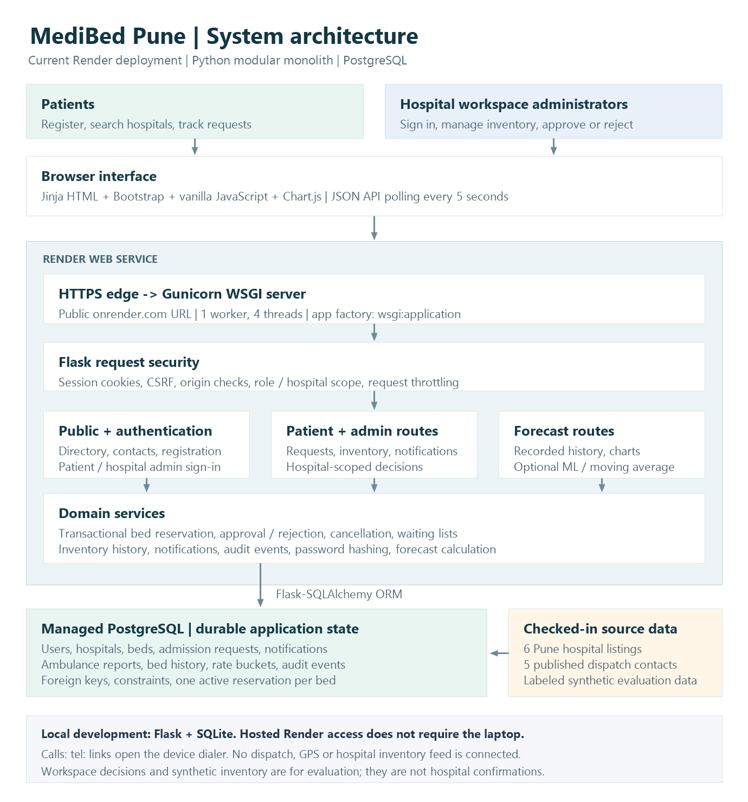

# MediBed Pune system architecture

Vector version: docs/architecture.svg. Editable Mermaid source: docs/architecture.mmd.

## Components and flow

MediBed is a modular Flask monolith. Jinja renders HTML; local Bootstrap, vanilla JavaScript and Chart.js provide browser interaction. Browser polling refreshes relevant JSON data every five seconds. Public pages, authentication, patient actions, hospital administration and forecast endpoints are Flask blueprints in one application.

Current hosted path: browser -> Render HTTPS edge -> Gunicorn (one worker, four threads) -> Flask security hooks -> route blueprints -> domain services / SQLAlchemy -> managed PostgreSQL. Local development uses SQLite and the localhost Flask server. The cloud path does not depend on the laptop, and the old Cloudflare tunnel/PythonAnywhere deployment is not on this path.

Session cookies, Werkzeug password hashes, CSRF/origin checks, role/hospital ownership guards and database-backed authentication throttles protect requests. Admin queries are scoped to the assigned hospital; patients can manage only their own requests.

Reservation approval conditionally changes an eligible physical bed from available to reserved and decides the request within one transaction. A partial unique index prevents more than one active approved request for the same bed. Rejection does not allocate a bed. Cancellation conditionally releases a reservation, while notifications and audit events record the outcome.

Nine tables persist users, hospitals, physical beds, admission requests, notifications, ambulance reports, daily bed history, rate-limit buckets and audit events. The directory is checked-in source data with public source links; startup does not scrape external websites. The current evaluation dataset contains clearly labeled synthetic Kaggle-derived inventory/history.

Forecasts run inside the Python service: at least seven recent recorded history days are required, with a moving-average fallback and optional Random Forest when enough history and ML dependencies are available. Chronological validation measures model error. No separate ML server, task queue or WebSocket service is used.

Tap-to-call links hand off directly to the visitor's dialer/calling app. They do not use a telephony gateway, reserve a vehicle or connect to a hospital dispatch system. No live hospital-feed integration or clinical prediction is claimed.

## Configuration and persistence

Live secrets are private Render environment values and are excluded from this archive. The hospital bootstrap mapping repairs/provisions only named hospital administrators; patient registrations remain in PostgreSQL. Private local runtime credentials, SQLite files and backups are also excluded. Source handover is separate from any authorized database migration.
